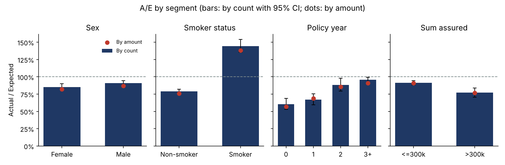
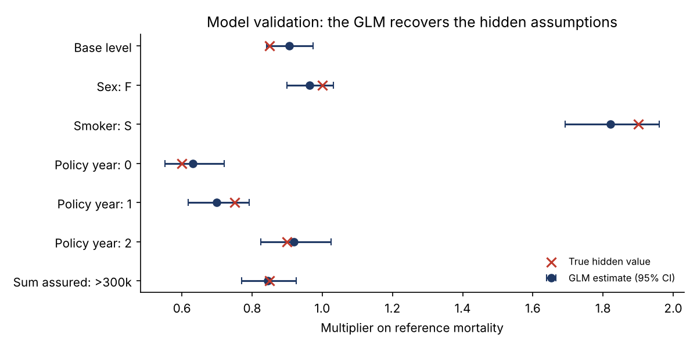

# Life Insurance Mortality Experience Study

[](https://github.com/yelbakali-creator/life-mortality-experience-study/actions/workflows/tests.yml)

An end-to-end actual-to-expected (A/E) mortality study in Python, built the way a life pricing or reinsurance team runs one: policy-level data, exact exposure calculation, A/E by segment with confidence intervals, credibility weighting and a Poisson GLM to set mortality assumptions.

The portfolio is simulated with known "true" mortality, so the study can be **validated**: the model must recover the hidden assumptions from the data alone. It does, for all seven parameters.

## Key results

| Metric | Result |
|---|---|
| Portfolio | 500,000 policies, observation window 2019-2023 |
| Exposure | 1,516,715 life-years |
| Deaths | 3,840 actual vs 4,307 expected |
| A/E by count | **89.2%** (95% CI 86.4% - 92.0%) |
| A/E by amount | **85.4%** |
| Smokers vs non-smokers | 144.5% vs 79.1% |
| Select effect | 60.5% in policy year 0, rising to 95.8% from year 3 |
| Sums assured above 300k | 77.1% |

**What it means for pricing:** mortality is about 11% lighter than the reference table by count, and lighter still by amount, because large policies carry healthier lives. A reinsurer pricing on sums at risk should use the amount-weighted basis, and select factors are material in the first two policy years.



## Model validation

The Poisson GLM recovers every hidden assumption within its 95% confidence interval.



| Parameter | True value | GLM estimate | 95% CI |
|---|---|---|---|
| Base level vs table | 0.85 | 0.91 | 0.84 - 0.97 |
| Female vs male | 1.00 | 0.96 | 0.90 - 1.03 |
| Smoker vs non-smoker | 1.90 | 1.82 | 1.69 - 1.96 |
| Policy year 0 | 0.60 | 0.63 | 0.55 - 0.72 |
| Policy year 1 | 0.75 | 0.70 | 0.62 - 0.79 |
| Policy year 2 | 0.90 | 0.92 | 0.82 - 1.03 |
| Sum assured > 300k | 0.85 | 0.84 | 0.77 - 0.93 |

## Method

**1. Data.** A policy administration extract: date of birth, sex, smoker status, sum assured, issue date, exit date and exit reason (death, lapse, in force). No ages or exposure are pre-computed.

**2. Exposure.** Each policy's time in force inside the observation window is cut at every birthday and every policy anniversary, so each segment has one attained age and one policy year. Central exposure is measured in years (days / 365.25), and each death is counted in the segment where it occurs.

**3. Expected deaths.** The reference table is a Gompertz-Makeham law, standing in for an industry table:

```math
\mu_x = A + B c^x, \qquad E = \sum_{\text{segments}} E^c_x \, \mu_{x+0.5}
```

**4. A/E and confidence intervals.** A/E is computed by count and by amount (deaths weighted by sum assured). 95% intervals use the exact Poisson method on the number of deaths.

**5. Credibility.** Limited fluctuation credibility: full credibility at 1,082 deaths (90% probability of being within 5%), partial credibility Z = sqrt(deaths / 1,082). The proposed assumption blends experience with the table: Z x A/E + (1 - Z) x 100%.

**6. Poisson GLM.** Deaths per cell (age band x sex x smoker x policy year x sum assured band) are modelled with a log link and log(expected deaths) as offset, so each exp(coefficient) is a multiplier on the reference table, controlling for all other factors at once. One-way A/E tables mix effects (for example, smokers cluster in some age bands); the GLM separates them.

## Data quality controls

The pipeline asserts that deaths in the exposure file reconcile exactly with deaths in the raw extract. This check caught a real edge case during development: a death on the first day of the observation window received zero exposure and was dropped. The fix counts the exit day as in force, and the reconciliation now holds exactly.

## Repository structure

```
├── run_study.py              # runs the whole study and writes all outputs
├── src/
│   ├── assumptions.py        # reference table and hidden true mortality
│   ├── simulate_portfolio.py # policy-level portfolio simulation
│   ├── exposure.py           # exposure split by age and policy year
│   └── analysis.py           # A/E, confidence intervals, credibility, GLM
└── results/
    ├── figures/              # charts
    ├── tables/               # A/E tables and GLM output (CSV)
    └── run_log.txt           # console output of the last run
```

## How to run

```bash
pip install -r requirements.txt
python -m pytest       # 5 automated validation tests
python run_study.py
```

The full run takes under a minute and regenerates every table and chart.

## Limitations and next steps

- Graduation of crude rates by age (Whittaker-Henderson or splines) to build a full smooth table.
- Mortality improvement over calendar years, and a claims-reporting delay (IBNR deaths) adjustment.
- A companion lapse study using the same exposure engine.
- Real data: the same pipeline applies to any policy extract with these fields.

## Why simulated data

Real insurer data is confidential and must never leave the company. A simulated portfolio with known true mortality makes the study reproducible and lets the method be tested against the right answer, which real data never provides.

---

**Author:** Yassine El Bakali, MSc in Actuarial Science (ULB) · yelbakali@yahoo.be
